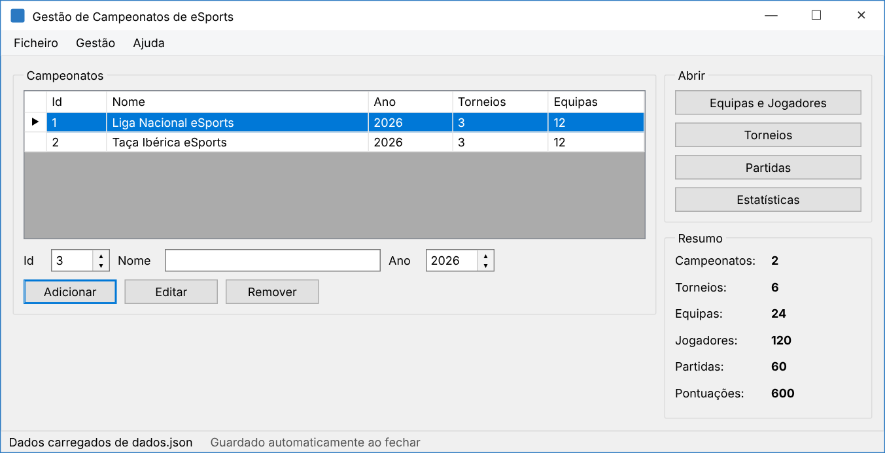
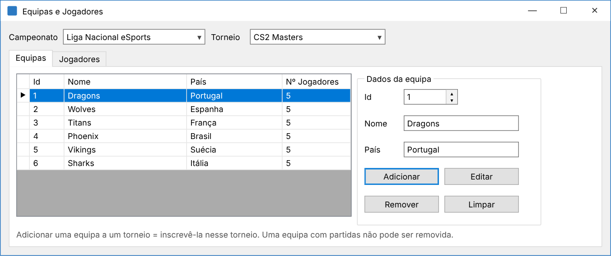
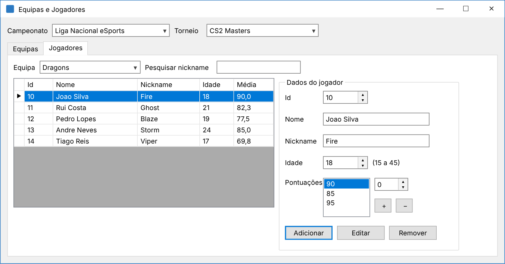
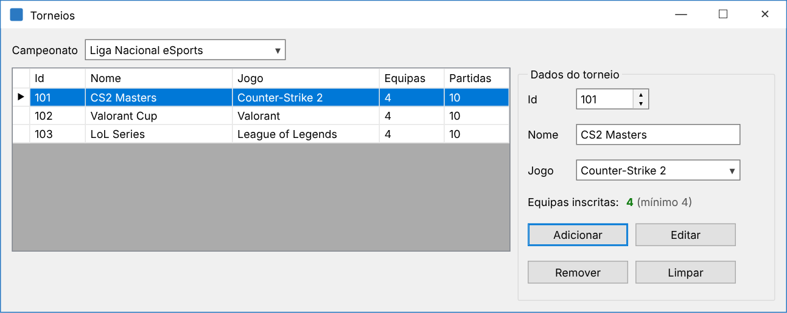
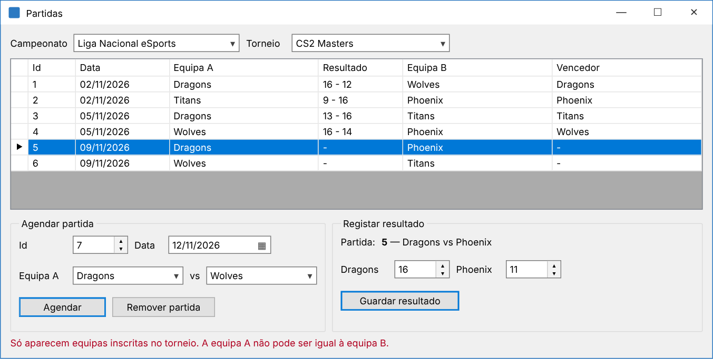
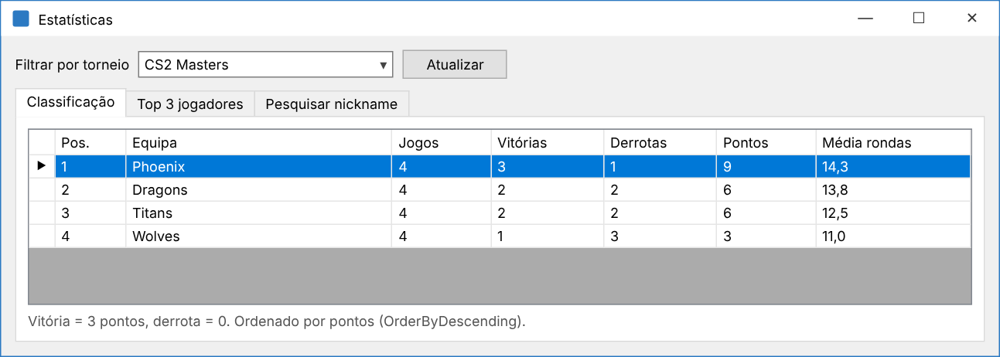
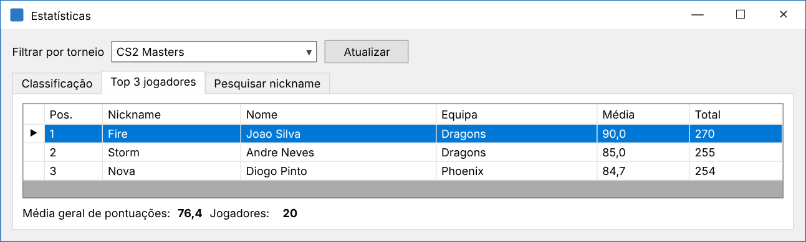
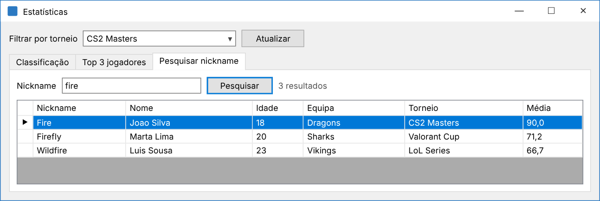

## PARA ATUALIZAR E MANDAR USEM ESTE CODIGO
git add .; git commit -m "Atualizacao"; git pull --no-edit origin main; git push origin HEAD

## PRIMEIRO ESTE PA RECONHECER O GIT (SO 1 VEZ)
$env:Path += ";C:\Program Files\Microsoft Visual Studio\2022\Community\Common7\IDE\CommonExtensions\Microsoft\TeamFoundation\Team Explorer\Git\cmd"

# Gestão de Campeonato de eSports

Aplicação Windows Forms em C# para gerir campeonatos, torneios, equipas, jogadores, partidas e classificações. Sem base de dados: tudo é lido e guardado em XML e JSON.

## Divisão de tarefas

| Quem | Faz |
|---|---|
| **Rodrigo** | Classes (`Models`), `DataService`, importar/exportar XML, `FormMain`, juntar o código de todos no Git |
| **Tiago** | Importar/exportar JSON, conversão XML↔JSON, erros de ficheiros malformados, guardar ao fechar e carregar ao abrir, `FormStatistics` (LINQ) |
| **Duarte** | `FormTeams`, `FormTournaments`, `FormMatches` e todas as validações |
| **Leslie** | Montar os forms no designer seguindo as tabelas desta página, dados de teste, ficheiros inválidos para testes, testes manuais, relatório e slides |

## Ecrãs (protótipos)

Protótipos dos forms da aplicação. Os dados das imagens são de exemplo. **Nomes de controlos e variáveis em inglês; textos visíveis ao utilizador em português.** As classes de dados (`Campeonato`, `Equipa`...) ficam em português para coincidirem com os nomes do XML e do JSON do professor.

### Como montar um form (para quem vai fazer o design)

1. **Add → Form (Windows Forms)** com o nome indicado (por exemplo `FormTeams`).
2. Na janela *Properties* do form, preencher `Text`, `ClientSize` e as outras propriedades da tabela *Propriedades do form*.
3. Arrastar os controlos da *Toolbox* pela ordem da tabela (primeiro os de *Dentro de* = `Form`, depois os que ficam dentro de `GroupBox` ou `TabPage`). Para pôr um controlo dentro de um `GroupBox`, arrasta-o para cima do `GroupBox`.
4. Para cada controlo preencher `(Name)`, `Text`, `Location` e `Size`. Em `Location` e `Size` escreve-se `x, y` e `largura, altura`.
5. Nas grelhas: clicar na seta no canto superior direito do `DataGridView` → *Edit Columns...* → *Add...* → *Unbound column*, e preencher `Name`, `HeaderText` e `Width` de cada coluna.
6. Definir o `TabIndex` pela ordem em que o utilizador deve percorrer os controlos.
7. Correr (F5) só para ver o aspeto. A lógica fica para quem tem o form atribuído.

As coordenadas são pontos de partida: se um texto ficar cortado, aumenta a largura do controlo. O que não pode mudar são os **Names**, porque o código dos outros depende deles.

### Convenção de nomes dos controlos

Prefixo do tipo de controlo mais o nome em inglês (por exemplo `txtNickname`, `btnAddTeam`).

| Prefixo | Controlo | Exemplo |
|---|---|---|
| `lbl` | Label | `lblTeamName` |
| `txt` | TextBox | `txtTeamName` |
| `btn` | Button | `btnAddTeam` |
| `cmb` | ComboBox | `cmbTournament` |
| `dgv` | DataGridView | `dgvPlayers` |
| `dtp` | DateTimePicker | `dtpDate` |
| `nud` | NumericUpDown | `nudAge` |
| `lst` | ListBox | `lstScores` |
| `grp` | GroupBox | `grpTeamData` |
| `mnu` | item de menu | `mnuImportXml` |
| `tabMain` / `tp...` | TabControl / cada TabPage | `tpPlayers` |
| `col...` | coluna de DataGridView | `colNickname` |

Regras gerais:
- Todos os `DataGridView` são `ReadOnly = True`, `SelectionMode = FullRowSelect`, `MultiSelect = False`. Ao clicar numa linha, os dados aparecem nas caixas ao lado para editar. Depois de cada operação a grelha é atualizada.
- `ComboBox` que escolhe uma opção da lista (campeonato, torneio, equipa): `DropDownStyle = DropDownList`.
- `Anchor` por defeito (`Top, Left`). Os forms têm tamanho fixo.

### FormMain

Gestão dos campeonatos, menu de ficheiros (importar, exportar, converter) e botões para abrir os outros forms. Ao abrir carrega `dados.json`; ao fechar (`FormClosing`) guarda automaticamente.



**Propriedades do form**

| Propriedade | Valor |
|---|---|
| `Name` | `FormMain` |
| `Text` | Gestão de Campeonatos de eSports |
| `ClientSize` | 884, 470 |
| `StartPosition` | CenterScreen |
| `Font` | Segoe UI, 9pt (por defeito) |

Form de arranque (`Application.Run(new FormMain())`). `MaximizeBox = False`.

**Itens do `menuMain` (MenuStrip)**

| Menu | Name | Texto |
|---|---|---|
| **Ficheiro** | `mnuFile` | Ficheiro |
| &nbsp;&nbsp;↳ | `mnuImportXml` | Importar XML... |
| &nbsp;&nbsp;↳ | `mnuImportJson` | Importar JSON... |
| &nbsp;&nbsp;— | `ToolStripSeparator` | separador |
| &nbsp;&nbsp;↳ | `mnuExportXml` | Exportar XML... |
| &nbsp;&nbsp;↳ | `mnuExportJson` | Exportar JSON... |
| &nbsp;&nbsp;— | `ToolStripSeparator` | separador |
| &nbsp;&nbsp;↳ | `mnuConvertXmlToJson` | Converter XML → JSON... |
| &nbsp;&nbsp;↳ | `mnuConvertJsonToXml` | Converter JSON → XML... |
| &nbsp;&nbsp;— | `ToolStripSeparator` | separador |
| &nbsp;&nbsp;↳ | `mnuExit` | Sair |
| **Gestão** | `mnuManage` | Gestão |
| &nbsp;&nbsp;↳ | `mnuTeams` | Equipas e Jogadores |
| &nbsp;&nbsp;↳ | `mnuTournaments` | Torneios |
| &nbsp;&nbsp;↳ | `mnuMatches` | Partidas |
| &nbsp;&nbsp;↳ | `mnuStatistics` | Estatísticas |
| **Ajuda** | `mnuHelp` | Ajuda |
| &nbsp;&nbsp;↳ | `mnuAbout` | Acerca de... |

**Controlos** (posições relativas ao controlo indicado em *Dentro de*; `auto` = `AutoSize = True`)

| Tipo | Name | Dentro de | Text | Location | Size | Outras propriedades |
|---|---|---|---|---|---|---|
| MenuStrip | `menuMain` | `Form` |  | 0, 0 | 884 x 24 | Dock = Top |
| GroupBox | `grpChampionships` | `Form` | Campeonatos | 12, 36 | 640 x 300 |  |
| DataGridView | `dgvChampionships` | `grpChampionships` |  | 12, 22 | 616 x 160 | ReadOnly, ver colunas abaixo |
| Label | `lblChampionshipId` | `grpChampionships` | Id | 12, 200 | auto |  |
| NumericUpDown | `nudChampionshipId` | `grpChampionships` |  | 40, 196 | 70 x 23 | Minimum = 1, Maximum = 9999 |
| Label | `lblChampionshipName` | `grpChampionships` | Nome | 124, 200 | auto |  |
| TextBox | `txtChampionshipName` | `grpChampionships` |  | 168, 196 | 240 x 23 | MaxLength = 60 |
| Label | `lblChampionshipYear` | `grpChampionships` | Ano | 424, 200 | auto |  |
| NumericUpDown | `nudChampionshipYear` | `grpChampionships` |  | 456, 196 | 80 x 23 | Minimum = 2000, Maximum = 2100, Value = 2026 |
| Button | `btnAddChampionship` | `grpChampionships` | Adicionar | 12, 240 | 100 x 27 |  |
| Button | `btnEditChampionship` | `grpChampionships` | Editar | 118, 240 | 100 x 27 |  |
| Button | `btnRemoveChampionship` | `grpChampionships` | Remover | 224, 240 | 100 x 27 |  |
| GroupBox | `grpOpen` | `Form` | Abrir | 664, 36 | 208 x 180 |  |
| Button | `btnTeams` | `grpOpen` | Equipas e Jogadores | 12, 24 | 184 x 30 |  |
| Button | `btnTournaments` | `grpOpen` | Torneios | 12, 62 | 184 x 30 |  |
| Button | `btnMatches` | `grpOpen` | Partidas | 12, 100 | 184 x 30 |  |
| Button | `btnStatistics` | `grpOpen` | Estatísticas | 12, 138 | 184 x 30 |  |
| GroupBox | `grpSummary` | `Form` | Resumo | 664, 228 | 208 x 190 |  |
| Label | `lblChampionshipsText` | `grpSummary` | Campeonatos: | 12, 26 | auto |  |
| Label | `lblTotalChampionships` | `grpSummary` | 0 | 120, 26 | auto | Font = Bold |
| Label | `lblTournamentsText` | `grpSummary` | Torneios: | 12, 54 | auto |  |
| Label | `lblTotalTournaments` | `grpSummary` | 0 | 120, 54 | auto | Font = Bold |
| Label | `lblTeamsText` | `grpSummary` | Equipas: | 12, 82 | auto |  |
| Label | `lblTotalTeams` | `grpSummary` | 0 | 120, 82 | auto | Font = Bold |
| Label | `lblPlayersText` | `grpSummary` | Jogadores: | 12, 110 | auto |  |
| Label | `lblTotalPlayers` | `grpSummary` | 0 | 120, 110 | auto | Font = Bold |
| Label | `lblMatchesText` | `grpSummary` | Partidas: | 12, 138 | auto |  |
| Label | `lblTotalMatches` | `grpSummary` | 0 | 120, 138 | auto | Font = Bold |
| Label | `lblScoresText` | `grpSummary` | Pontuações: | 12, 166 | auto |  |
| Label | `lblTotalScores` | `grpSummary` | 0 | 120, 166 | auto | Font = Bold |
| StatusStrip | `statusMain` | `Form` |  | 0, 448 | 884 x 22 | Dock = Bottom |
| ToolStripStatusLabel | `lblStatus` | `statusMain` | Pronto |  |  | Spring = False |
| ToolStripStatusLabel | `lblAutoSave` | `statusMain` | Guardado automaticamente ao fechar |  |  | ForeColor = DimGray |
| OpenFileDialog | `openFileDialog` | Form (componente) |  |  |  | Filter = "XML (*.xml)\|*.xml\|JSON (*.json)\|*.json" |
| SaveFileDialog | `saveFileDialog` | Form (componente) |  |  |  | Filter igual ao anterior |

**Colunas do `dgvChampionships`** (`AutoGenerateColumns = False`, `AllowUserToAddRows = False`, `AllowUserToDeleteRows = False`, `SelectionMode = FullRowSelect`, `MultiSelect = False`, `RowHeadersVisible = False`)

| Name | HeaderText | Largura |
|---|---|---|
| `colId` | Id | 50 |
| `colName` | Nome | 260 |
| `colYear` | Ano | 70 |
| `colTournaments` | Torneios | 100 |
| `colTeams` | Equipas | AutoSizeMode = Fill |

Ordem de tabulação: `dgvChampionships`, `nudChampionshipId`, `txtChampionshipName`, `nudChampionshipYear`, `btnAddChampionship`, `btnEditChampionship`, `btnRemoveChampionship`, `btnTeams`, `btnTournaments`, `btnMatches`, `btnStatistics`.


---

### FormTeams

Gestão das equipas e dos jogadores de um torneio. Adicionar uma equipa a um torneio é inscrevê-la nesse torneio.




**Propriedades do form**

| Propriedade | Valor |
|---|---|
| `Name` | `FormTeams` |
| `Text` | Equipas e Jogadores |
| `ClientSize` | 884, 450 |
| `StartPosition` | CenterScreen |
| `Font` | Segoe UI, 9pt (por defeito) |

`FormBorderStyle = FixedDialog`, `MaximizeBox = False`, `MinimizeBox = False`, `ShowInTaskbar = False`. Abre com `ShowDialog()` a partir do `FormMain`.

**Controlos** (posições relativas ao controlo indicado em *Dentro de*; `auto` = `AutoSize = True`)

| Tipo | Name | Dentro de | Text | Location | Size | Outras propriedades |
|---|---|---|---|---|---|---|
| Label | `lblChampionship` | `Form` | Campeonato | 12, 16 | auto |  |
| ComboBox | `cmbChampionship` | `Form` |  | 84, 12 | 210 x 23 | DropDownStyle = DropDownList |
| Label | `lblTournament` | `Form` | Torneio | 312, 16 | auto |  |
| ComboBox | `cmbTournament` | `Form` |  | 364, 12 | 200 x 23 | DropDownStyle = DropDownList |
| TabControl | `tabMain` | `Form` |  | 12, 44 | 860 x 394 |  |
| TabPage | `tpTeams` | `tabMain` | Equipas |  |  |  |
| DataGridView | `dgvTeams` | `tpTeams` |  | 10, 10 | 500 x 300 | ReadOnly, ver colunas abaixo |
| GroupBox | `grpTeamData` | `tpTeams` | Dados da equipa | 524, 10 | 318 x 212 |  |
| Label | `lblTeamId` | `grpTeamData` | Id | 14, 32 | auto |  |
| NumericUpDown | `nudTeamId` | `grpTeamData` |  | 90, 28 | 80 x 23 | Minimum = 1, Maximum = 9999 |
| Label | `lblTeamName` | `grpTeamData` | Nome | 14, 68 | auto |  |
| TextBox | `txtTeamName` | `grpTeamData` |  | 90, 64 | 210 x 23 | MaxLength = 40 |
| Label | `lblTeamCountry` | `grpTeamData` | País | 14, 104 | auto |  |
| TextBox | `txtTeamCountry` | `grpTeamData` |  | 90, 100 | 210 x 23 | MaxLength = 40 |
| Button | `btnAddTeam` | `grpTeamData` | Adicionar | 14, 138 | 140 x 27 |  |
| Button | `btnEditTeam` | `grpTeamData` | Editar | 160, 138 | 140 x 27 |  |
| Button | `btnRemoveTeam` | `grpTeamData` | Remover | 14, 172 | 140 x 27 |  |
| Button | `btnClearTeam` | `grpTeamData` | Limpar | 160, 172 | 140 x 27 |  |
| Label | `lblTeamsHint` | `tpTeams` | Uma equipa com partidas registadas não pode ser removida. | 10, 322 | auto | ForeColor = DimGray |
| TabPage | `tpPlayers` | `tabMain` | Jogadores |  |  |  |
| Label | `lblTeam` | `tpPlayers` | Equipa | 10, 16 | auto |  |
| ComboBox | `cmbTeam` | `tpPlayers` |  | 60, 12 | 180 x 23 | DropDownStyle = DropDownList |
| Label | `lblSearchNickname` | `tpPlayers` | Pesquisar nickname | 262, 16 | auto |  |
| TextBox | `txtSearchNickname` | `tpPlayers` |  | 380, 12 | 160 x 23 | filtra a grelha enquanto escreve (TextChanged) |
| DataGridView | `dgvPlayers` | `tpPlayers` |  | 10, 44 | 500 x 290 | ReadOnly, ver colunas abaixo |
| GroupBox | `grpPlayerData` | `tpPlayers` | Dados do jogador | 524, 44 | 318 x 290 |  |
| Label | `lblPlayerId` | `grpPlayerData` | Id | 14, 32 | auto |  |
| NumericUpDown | `nudPlayerId` | `grpPlayerData` |  | 100, 28 | 80 x 23 | Minimum = 1, Maximum = 99999 |
| Label | `lblPlayerName` | `grpPlayerData` | Nome | 14, 68 | auto |  |
| TextBox | `txtPlayerName` | `grpPlayerData` |  | 100, 64 | 200 x 23 | MaxLength = 60 |
| Label | `lblNickname` | `grpPlayerData` | Nickname | 14, 104 | auto |  |
| TextBox | `txtNickname` | `grpPlayerData` |  | 100, 100 | 200 x 23 | MaxLength = 30 |
| Label | `lblAge` | `grpPlayerData` | Idade | 14, 140 | auto |  |
| NumericUpDown | `nudAge` | `grpPlayerData` |  | 100, 136 | 80 x 23 | Minimum = 15, Maximum = 45, Value = 18 |
| Label | `lblAgeHint` | `grpPlayerData` | (15 a 45) | 190, 140 | auto | ForeColor = DimGray |
| Label | `lblScores` | `grpPlayerData` | Pontuações | 14, 176 | auto |  |
| ListBox | `lstScores` | `grpPlayerData` |  | 100, 172 | 80 x 66 |  |
| NumericUpDown | `nudScore` | `grpPlayerData` |  | 190, 172 | 80 x 23 | Minimum = 0, Maximum = 100 |
| Button | `btnAddScore` | `grpPlayerData` | + | 190, 202 | 38 x 27 |  |
| Button | `btnRemoveScore` | `grpPlayerData` | − | 234, 202 | 38 x 27 |  |
| Button | `btnAddPlayer` | `grpPlayerData` | Adicionar | 14, 252 | 92 x 27 |  |
| Button | `btnEditPlayer` | `grpPlayerData` | Editar | 112, 252 | 92 x 27 |  |
| Button | `btnRemovePlayer` | `grpPlayerData` | Remover | 210, 252 | 92 x 27 |  |

**Colunas do `dgvTeams`** (`AutoGenerateColumns = False`, `AllowUserToAddRows = False`, `AllowUserToDeleteRows = False`, `SelectionMode = FullRowSelect`, `MultiSelect = False`, `RowHeadersVisible = False`)

| Name | HeaderText | Largura |
|---|---|---|
| `colId` | Id | 50 |
| `colName` | Nome | 200 |
| `colCountry` | País | 140 |
| `colPlayers` | Nº Jogadores | AutoSizeMode = Fill |

**Colunas do `dgvPlayers`** (`AutoGenerateColumns = False`, `AllowUserToAddRows = False`, `AllowUserToDeleteRows = False`, `SelectionMode = FullRowSelect`, `MultiSelect = False`, `RowHeadersVisible = False`)

| Name | HeaderText | Largura |
|---|---|---|
| `colId` | Id | 50 |
| `colName` | Nome | 150 |
| `colNickname` | Nickname | 110 |
| `colAge` | Idade | 60 |
| `colAverage` | Média | AutoSizeMode = Fill |

Ordem de tabulação em `tpTeams`: `dgvTeams`, `nudTeamId`, `txtTeamName`, `txtTeamCountry`, `btnAddTeam`, `btnEditTeam`, `btnRemoveTeam`, `btnClearTeam`.


---

### FormTournaments

Criar, editar e remover torneios de um campeonato. Mostra quantas equipas estão inscritas (mínimo 4).



**Propriedades do form**

| Propriedade | Valor |
|---|---|
| `Name` | `FormTournaments` |
| `Text` | Torneios |
| `ClientSize` | 860, 330 |
| `StartPosition` | CenterScreen |
| `Font` | Segoe UI, 9pt (por defeito) |

`FormBorderStyle = FixedDialog`, `MaximizeBox = False`, `MinimizeBox = False`, `ShowInTaskbar = False`. Abre com `ShowDialog()`.

**Controlos** (posições relativas ao controlo indicado em *Dentro de*; `auto` = `AutoSize = True`)

| Tipo | Name | Dentro de | Text | Location | Size | Outras propriedades |
|---|---|---|---|---|---|---|
| Label | `lblChampionship` | `Form` | Campeonato | 12, 16 | auto |  |
| ComboBox | `cmbChampionship` | `Form` |  | 84, 12 | 220 x 23 | DropDownStyle = DropDownList |
| DataGridView | `dgvTournaments` | `Form` |  | 12, 44 | 500 x 240 | ReadOnly, ver colunas abaixo |
| GroupBox | `grpTournamentData` | `Form` | Dados do torneio | 526, 44 | 320 x 250 |  |
| Label | `lblTournamentId` | `grpTournamentData` | Id | 14, 32 | auto |  |
| NumericUpDown | `nudTournamentId` | `grpTournamentData` |  | 90, 28 | 80 x 23 | Minimum = 1, Maximum = 9999 |
| Label | `lblTournamentName` | `grpTournamentData` | Nome | 14, 68 | auto |  |
| TextBox | `txtTournamentName` | `grpTournamentData` |  | 90, 64 | 210 x 23 | MaxLength = 60 |
| Label | `lblGame` | `grpTournamentData` | Jogo | 14, 104 | auto |  |
| ComboBox | `cmbGame` | `grpTournamentData` |  | 90, 100 | 210 x 23 | DropDownStyle = DropDown (editável); Items: Counter-Strike 2, Valorant, League of Legends, Dota 2, Rocket League |
| Label | `lblEnrolledText` | `grpTournamentData` | Equipas inscritas: | 14, 140 | auto |  |
| Label | `lblEnrolledTeams` | `grpTournamentData` | 0 | 122, 140 | auto | Font = Bold; verde se ≥ 4, vermelho se < 4 |
| Label | `lblMinTeams` | `grpTournamentData` | (mínimo 4) | 148, 140 | auto | ForeColor = DimGray |
| Button | `btnAddTournament` | `grpTournamentData` | Adicionar | 14, 174 | 140 x 27 |  |
| Button | `btnEditTournament` | `grpTournamentData` | Editar | 160, 174 | 140 x 27 |  |
| Button | `btnRemoveTournament` | `grpTournamentData` | Remover | 14, 208 | 140 x 27 |  |
| Button | `btnClearTournament` | `grpTournamentData` | Limpar | 160, 208 | 140 x 27 |  |
| Label | `lblEnrollHint` | `Form` | As equipas são inscritas no form Equipas e Jogadores. | 12, 296 | auto | ForeColor = DimGray |

**Colunas do `dgvTournaments`** (`AutoGenerateColumns = False`, `AllowUserToAddRows = False`, `AllowUserToDeleteRows = False`, `SelectionMode = FullRowSelect`, `MultiSelect = False`, `RowHeadersVisible = False`)

| Name | HeaderText | Largura |
|---|---|---|
| `colId` | Id | 50 |
| `colName` | Nome | 160 |
| `colGame` | Jogo | 150 |
| `colTeams` | Equipas | 60 |
| `colMatches` | Partidas | AutoSizeMode = Fill |


---

### FormMatches

Agendar partidas e registar resultados. Os combos das equipas só mostram as equipas inscritas no torneio escolhido.



**Propriedades do form**

| Propriedade | Valor |
|---|---|
| `Name` | `FormMatches` |
| `Text` | Partidas |
| `ClientSize` | 884, 436 |
| `StartPosition` | CenterScreen |
| `Font` | Segoe UI, 9pt (por defeito) |

`FormBorderStyle = FixedDialog`, `MaximizeBox = False`, `MinimizeBox = False`, `ShowInTaskbar = False`. Abre com `ShowDialog()`.

**Controlos** (posições relativas ao controlo indicado em *Dentro de*; `auto` = `AutoSize = True`)

| Tipo | Name | Dentro de | Text | Location | Size | Outras propriedades |
|---|---|---|---|---|---|---|
| Label | `lblChampionship` | `Form` | Campeonato | 12, 16 | auto |  |
| ComboBox | `cmbChampionship` | `Form` |  | 84, 12 | 210 x 23 | DropDownStyle = DropDownList |
| Label | `lblTournament` | `Form` | Torneio | 312, 16 | auto |  |
| ComboBox | `cmbTournament` | `Form` |  | 364, 12 | 200 x 23 | DropDownStyle = DropDownList |
| DataGridView | `dgvMatches` | `Form` |  | 12, 44 | 860 x 190 | ReadOnly, ver colunas abaixo |
| GroupBox | `grpSchedule` | `Form` | Agendar partida | 12, 246 | 420 x 150 |  |
| Label | `lblMatchId` | `grpSchedule` | Id | 14, 30 | auto |  |
| NumericUpDown | `nudMatchId` | `grpSchedule` |  | 80, 26 | 70 x 23 | Minimum = 1, Maximum = 9999 |
| Label | `lblDate` | `grpSchedule` | Data | 170, 30 | auto |  |
| DateTimePicker | `dtpDate` | `grpSchedule` |  | 212, 26 | 130 x 23 | Format = Short |
| Label | `lblTeamA` | `grpSchedule` | Equipa A | 14, 66 | auto |  |
| ComboBox | `cmbTeamA` | `grpSchedule` |  | 80, 62 | 140 x 23 | DropDownStyle = DropDownList |
| Label | `lblVs` | `grpSchedule` | vs | 230, 66 | auto |  |
| ComboBox | `cmbTeamB` | `grpSchedule` |  | 256, 62 | 140 x 23 | DropDownStyle = DropDownList |
| Button | `btnSchedule` | `grpSchedule` | Agendar | 14, 106 | 110 x 27 |  |
| Button | `btnRemoveMatch` | `grpSchedule` | Remover partida | 130, 106 | 130 x 27 |  |
| GroupBox | `grpResult` | `Form` | Registar resultado | 446, 246 | 426 x 150 |  |
| Label | `lblSelectedMatch` | `grpResult` | Partida: (nenhuma selecionada) | 14, 30 | auto | Font = Bold |
| Label | `lblScoreTeamA` | `grpResult` | Equipa A | 14, 70 | auto | texto muda para o nome da equipa A |
| NumericUpDown | `nudScoreA` | `grpResult` |  | 100, 66 | 70 x 23 | Minimum = 0, Maximum = 99 |
| Label | `lblScoreTeamB` | `grpResult` | Equipa B | 200, 70 | auto | texto muda para o nome da equipa B |
| NumericUpDown | `nudScoreB` | `grpResult` |  | 286, 66 | 70 x 23 | Minimum = 0, Maximum = 99 |
| Button | `btnSaveResult` | `grpResult` | Guardar resultado | 14, 106 | 150 x 27 |  |
| Label | `lblWarning` | `Form` | Só aparecem equipas inscritas no torneio. A equipa A não pode ser igual à equipa B. | 12, 406 | auto | ForeColor = Firebrick |

**Colunas do `dgvMatches`** (`AutoGenerateColumns = False`, `AllowUserToAddRows = False`, `AllowUserToDeleteRows = False`, `SelectionMode = FullRowSelect`, `MultiSelect = False`, `RowHeadersVisible = False`)

| Name | HeaderText | Largura |
|---|---|---|
| `colId` | Id | 40 |
| `colDate` | Data | 90 |
| `colTeamA` | Equipa A | 150 |
| `colResult` | Resultado | 80 |
| `colTeamB` | Equipa B | 150 |
| `colWinner` | Vencedor | AutoSizeMode = Fill |


---

### FormStatistics

Classificações, melhores jogadores e pesquisa, tudo feito com LINQ e expressões lambda.





**Propriedades do form**

| Propriedade | Valor |
|---|---|
| `Name` | `FormStatistics` |
| `Text` | Estatísticas |
| `ClientSize` | 860, 430 |
| `StartPosition` | CenterScreen |
| `Font` | Segoe UI, 9pt (por defeito) |

`FormBorderStyle = FixedDialog`, `MaximizeBox = False`, `MinimizeBox = False`, `ShowInTaskbar = False`. Abre com `ShowDialog()`.

**Controlos** (posições relativas ao controlo indicado em *Dentro de*; `auto` = `AutoSize = True`)

| Tipo | Name | Dentro de | Text | Location | Size | Outras propriedades |
|---|---|---|---|---|---|---|
| Label | `lblTournamentFilter` | `Form` | Filtrar por torneio | 12, 16 | auto |  |
| ComboBox | `cmbTournamentFilter` | `Form` |  | 130, 12 | 220 x 23 | DropDownStyle = DropDownList; primeiro item: Todos os torneios |
| Button | `btnRefresh` | `Form` | Atualizar | 360, 10 | 90 x 27 |  |
| TabControl | `tabMain` | `Form` |  | 12, 44 | 836 x 370 |  |
| TabPage | `tpStandings` | `tabMain` | Classificação |  |  |  |
| DataGridView | `dgvStandings` | `tpStandings` |  | 10, 10 | 814 x 280 | ReadOnly, ver colunas abaixo |
| Label | `lblStandingsHint` | `tpStandings` | Vitória = 3 pontos, derrota = 0. | 10, 300 | auto | ForeColor = DimGray |
| TabPage | `tpTop3` | `tabMain` | Top 3 jogadores |  |  |  |
| DataGridView | `dgvTop3` | `tpTop3` |  | 10, 10 | 814 x 110 | ReadOnly, ver colunas abaixo |
| Label | `lblOverallAverageText` | `tpTop3` | Média geral de pontuações: | 10, 136 | auto |  |
| Label | `lblOverallAverage` | `tpTop3` | 0 | 170, 136 | auto | Font = Bold |
| Label | `lblPlayersCountText` | `tpTop3` | Jogadores: | 240, 136 | auto |  |
| Label | `lblPlayersCount` | `tpTop3` | 0 | 306, 136 | auto | Font = Bold |
| TabPage | `tpSearch` | `tabMain` | Pesquisar nickname |  |  |  |
| Label | `lblSearch` | `tpSearch` | Nickname | 10, 16 | auto |  |
| TextBox | `txtSearch` | `tpSearch` |  | 78, 12 | 200 x 23 |  |
| Button | `btnSearch` | `tpSearch` | Pesquisar | 288, 11 | 95 x 27 | AcceptButton do separador |
| Label | `lblResultsCount` | `tpSearch` | 0 resultados | 400, 16 | auto | ForeColor = DimGray |
| DataGridView | `dgvSearchResults` | `tpSearch` |  | 10, 44 | 814 x 260 | ReadOnly, ver colunas abaixo |

**Colunas do `dgvStandings`** (`AutoGenerateColumns = False`, `AllowUserToAddRows = False`, `AllowUserToDeleteRows = False`, `SelectionMode = FullRowSelect`, `MultiSelect = False`, `RowHeadersVisible = False`)

| Name | HeaderText | Largura |
|---|---|---|
| `colPosition` | Pos. | 50 |
| `colTeam` | Equipa | 200 |
| `colPlayed` | Jogos | 70 |
| `colWins` | Vitórias | 80 |
| `colLosses` | Derrotas | 80 |
| `colPoints` | Pontos | 70 |
| `colAverage` | Média rondas | AutoSizeMode = Fill |

**Colunas do `dgvTop3`** (`AutoGenerateColumns = False`, `AllowUserToAddRows = False`, `AllowUserToDeleteRows = False`, `SelectionMode = FullRowSelect`, `MultiSelect = False`, `RowHeadersVisible = False`)

| Name | HeaderText | Largura |
|---|---|---|
| `colPosition` | Pos. | 50 |
| `colNickname` | Nickname | 110 |
| `colName` | Nome | 160 |
| `colTeam` | Equipa | 130 |
| `colAverage` | Média | 70 |
| `colTotal` | Total | AutoSizeMode = Fill |

**Colunas do `dgvSearchResults`** (`AutoGenerateColumns = False`, `AllowUserToAddRows = False`, `AllowUserToDeleteRows = False`, `SelectionMode = FullRowSelect`, `MultiSelect = False`, `RowHeadersVisible = False`)

| Name | HeaderText | Largura |
|---|---|---|
| `colNickname` | Nickname | 100 |
| `colName` | Nome | 140 |
| `colAge` | Idade | 50 |
| `colTeam` | Equipa | 110 |
| `colTournament` | Torneio | 130 |
| `colAverage` | Média | AutoSizeMode = Fill |


---

# REGRAS (VALIDAÇÕES)

- IDs únicos dentro do seu âmbito (equipa única no torneio, jogador único na equipa, etc.)
- Nome e nickname obrigatórios
- Idade entre 15 e 45 anos
- Pontuações entre 0 e 100
- Não deixar remover uma equipa com partidas registadas
- Torneio com pelo menos 4 equipas inscritas para agendar partidas
- Uma equipa não pode jogar contra si própria
- Só podem jogar equipas inscritas no torneio
- Ficheiro malformado ou dados inválidos: `try/catch` e `MessageBox` com o erro, sem fechar a aplicação

Pontos na classificação: vitória = 3, derrota = 0.

## LINQ usado nas estatísticas

| O quê | LINQ usado |
|---|---|
| Classificação | `Where` (partidas com resultado), `Select` (vitórias, derrotas, pontos por equipa), `OrderByDescending` (pontos) |
| Pontos e médias | `Sum`, `Average` |
| Top 3 jogadores | `SelectMany`, `OrderByDescending(j => j.Pontuacoes.Average())`, `Take(3)` |
| Pesquisa por nickname | `Where(j => j.Nickname.ToLower().Contains(text))` |
| Equipa tem partidas? | `Any` (para impedir a remoção) |

## Estrutura do projeto

```
App1-Esports/
├── Models/        Dados, Campeonato, Torneio, Equipa, Jogador, Partida, StandingRow
├── Services/      DataService, XmlService, JsonService, StatisticsService, Validations
├── Forms/         FormMain, FormTeams, FormTournaments, FormMatches, FormStatistics
└── Dados/         campeonatos.xml, campeonatos.json, resultados.json, dados_invalidos.*
```

Os forms não têm lógica: só chamam métodos dos `Services` e mostram o resultado.

A raiz dos dados é a classe `Dados` (guardada em `dados.json`). Tem a lista de campeonatos; cada campeonato tem torneios; cada torneio tem equipas e partidas; cada equipa tem jogadores; cada jogador tem a lista de pontuações. As partidas guardam só os IDs das equipas.


## Classes e variáveis

| Classe | Variáveis |
|---|---|
| `Dados` | `List<Campeonato> Campeonatos` |
| `Campeonato` | `int Id`, `string Nome`, `int Ano`, `List<Torneio> Torneios` |
| `Torneio` | `int Id`, `string Nome`, `string Jogo`, `List<Equipa> Equipas`, `List<Partida> Partidas` |
| `Equipa` | `int Id`, `string Nome`, `string Pais`, `List<Jogador> Jogadores` |
| `Jogador` | `int Id`, `string Nome`, `string Nickname`, `int Idade`, `List<int> Pontuacoes` |
| `Partida` | `int Id`, `DateTime Data`, `int IdEquipaA`, `int IdEquipaB`, `int? ResultadoA`, `int? ResultadoB` |
| `StandingRow` (não é guardada) | `int Position`, `string Team`, `int Played`, `int Wins`, `int Losses`, `int Points`, `double Average` |

`ResultadoA` e `ResultadoB` são `int?` (null = partida ainda por jogar).

### Atributos para o XML e o JSON ficarem iguais aos do professor

| Onde | XML | JSON |
|---|---|---|
| `Dados` | `[XmlRoot("Campeonatos")]` | — |
| `Dados.Campeonatos` | `[XmlElement("Campeonato")]` | `[JsonPropertyName("campeonatos")]` |
| `Jogador.Pontuacoes` | `[XmlArray("Pontuacoes")]` + `[XmlArrayItem("Ponto")]` | — |
| Todas as propriedades | nome igual à propriedade (`<Nome>`) | `PropertyNamingPolicy = JsonNamingPolicy.CamelCase` (`"nome"`) |
